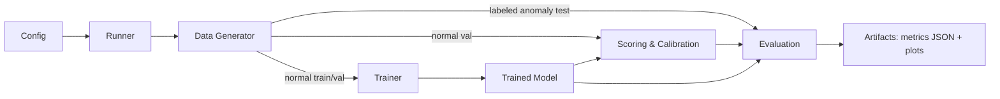

# Directional Deviation Detection Experiment Design (Protocol B)

## Overview

This document describes the design of Protocol B (“Directional Deviation Detection; resource constrained”) for evaluating the Sign-Aware Gated Sparse Autoencoder against baseline SAE variants on synthetic “sensor array” data.

The experiment is intended to answer:
- Under a strict latent budget \(H < N\), how well can each model detect “too high” (\(+\Delta\)) vs “too low” (\(-\Delta\)) deviations?
- Does the Sign-Aware gate provide direction-aware detection at fixed false-positive rate, and improve “both-directions” coverage under the same latent budget?

Implementation will follow the structure and conventions of the existing experiment module `sgnsae.experiments.polarity_dial`:
- dataclass-based config models with JSON/YAML loading,
- a runner that creates structured run directories under `[output_dir]/<experiment_name>/<run_id>/`,
- reusable training orchestration per model variant,
- evaluation utilities that write machine-readable JSON artifacts and (optional) plots.

## Architecture

The experiment is split into five subsystems:

1. Data generation:
   - Module: `sgnsae.experiments.directional_deviation.data`
   - Generates normal train/validation/test data and labeled anomaly test data.

2. Training and model orchestration:
   - Module: `sgnsae.experiments.directional_deviation.training`
   - Trains SAE variants under a fixed width \(H\) (and optionally in a sweep over widths).

3. Scoring and calibration:
   - Module: `sgnsae.experiments.directional_deviation.scoring`
   - Extracts per-latent detection signals, calibrates per-latent thresholds \((\tau_i^+, \tau_i^-)\), and computes directional scores.

4. Evaluation:
   - Module: `sgnsae.experiments.directional_deviation.evaluation`
   - Computes Directional Recall @ Fixed FPR for high and low anomalies, plus optional per-channel coverage metrics.

5. Plotting and reporting:
   - Module: `sgnsae.experiments.directional_deviation.plotting`
   - Generates plots (recall vs \(H\), coverage vs \(H\), score histograms) and writes summary/comparison JSON artifacts.

CLI entrypoint:
- Script: `sgnsae/scripts/run_directional_deviation_experiment.py`
- Loads a config, dispatches to the runner, and prints the final run directory path.

Mermaid diagram (dataflow):



## Components and Interfaces

### Configuration

Module: `sgnsae.experiments.directional_deviation.config`

Config objects are dataclasses (matching the existing `polarity_dial` style) and must validate inputs in `__post_init__` with clear `ValueError` messages.

Recommended models:

- `DirectionalDeviationDataConfig`
  - `seed: int`
  - `seeds: Optional[List[int]]` (optional; if set, runner executes one sub-run per seed and collates)
  - `num_train: int`
  - `num_val: int`
  - `num_test_normal: int`
  - `num_test_high_per_channel: int`
  - `num_test_low_per_channel: int`
  - `num_channels: int` (\(N\))
  - `noise_std: float` (optional; default `0.0` to match \(\mathcal{N}(0, I)\) exactly)
  - `normal_mode: Literal["standard_normal", "heteroskedastic_normal"]` (optional; default `"standard_normal"`)
  - `channel_stds: Optional[List[float]]` (required if `normal_mode="heteroskedastic_normal"`)
  - `anomaly_eval_mode: Literal["materialize", "stream"]` (optional; default `"stream"` for memory safety)

- `DirectionalDeviationAnomalyConfig`
  - `delta: float` (\(\Delta\))
  - `shift_mode: Literal["single_channel", "subset"]`
  - `subset_size: Optional[int]` (required for `shift_mode="subset"`)
  - `channels_to_evaluate: Optional[List[int]]` (default: all channels)

- `DirectionalDeviationThresholdConfig`
  - `latent_quantile: float` (default: `0.99` for \(\tau_i^+\), \(\tau_i^-\))
  - `score_fpr: float` (default: `0.01` for per-direction score thresholds)
  - `min_validation_samples: int` (default: `1000`)
  - `deterministic_algorithms: bool` (optional; default `False`; if `True`, enable framework deterministic settings when possible)

- `DirectionalDeviationModelVariantConfig`
  - `name: str` (e.g., `"relu_sae"`, `"gated_sae"`, `"sign_aware_gated_sae"`)
  - `sae_class: str` (`"SAE"` or `"GatedSAE"`)
  - `sign_aware: bool`
  - `single_activation_offset: bool`
  - `reset_activation_offsets_on_resample: bool`
  - `symmetric_magnitude: bool` (only meaningful for sign-aware gated)
  - `d_hidden: int` (\(H\))
  - `sparsity_coeff: float`
  - `learning_rate: float`
  - `num_epochs: int`
  - `batch_size: int`
  - `adam_betas: Tuple[float, float]`
  - `resample_latents_epochs: float`

- `DirectionalDeviationExperimentConfig`
  - `output_dir: str`
  - `device: Literal["cpu", "cuda", "auto"]`
  - `data: DirectionalDeviationDataConfig`
  - `anomaly: DirectionalDeviationAnomalyConfig`
  - `thresholds: DirectionalDeviationThresholdConfig`
  - `models: List[DirectionalDeviationModelVariantConfig]`
  - `width_sweep: Optional[List[int]]` (if set, overrides `d_hidden` per variant to produce budget sweeps)
  - `run_id: Optional[str]`
  - `verbose: bool`
  - `log_every_n_steps: int`
  - `log_every_n_epochs: int`
  - `wandb_project: Optional[str]`
  - `wandb_api_key: Optional[str]` (optional; if provided, MUST be redacted and MUST NOT be persisted to run artifacts)

### Data Generation

Module: `sgnsae.experiments.directional_deviation.data`

Core functions:

```python
def generate_normal_data(
    config: DirectionalDeviationDataConfig,
    device: str,
) -> dict[str, torch.Tensor]:
    ...

def generate_anomaly_test_data(
    config: DirectionalDeviationDataConfig,
    anomaly_config: DirectionalDeviationAnomalyConfig,
    device: str,
) -> dict[str, torch.Tensor]:
    ...
```

Normal samples:
- Train/val/test-normal splits are drawn IID from \(\mathcal{N}(0, I)\) componentwise.
- If `normal_mode="heteroskedastic_normal"`, draw IID per-channel with \(x_j \sim \mathcal{N}(0, \sigma_j^2)\) using `channel_stds`, and persist `channel_stds` in `generator_config.json` to make symmetry-breaking explicit.

Anomaly samples:
- For each evaluated channel \(j\) (or each evaluated subset pattern), generate:
  - high anomalies: \(x = x_{\text{base}} + \Delta \cdot m\)
  - low anomalies: \(x = x_{\text{base}} - \Delta \cdot m\)
  where \(m\) is:
  - `single_channel`: the standard basis vector \(e_j\),
  - `subset`: a binary mask with exactly `subset_size` ones (chosen deterministically from the seed, or provided explicitly).
- If `anomaly_eval_mode="stream"`, the system may avoid materializing a full `x_test_anomaly` tensor; instead it SHALL provide a memory-safe iterable/batched interface for scoring and evaluation while still producing deterministic labels and an `anomaly_manifest.json`.

Labels:
- `labels_type: Tensor[int]` with values `{0=normal, 1=high, 2=low}`
- `labels_channel: Tensor[int]` with the affected channel index (or `-1` for subset anomalies if not attributable to a single channel)
- `labels_mask: Optional[Tensor]` (for subset mode), to record the exact shifted coordinates

Exports:
- Mirror `polarity_dial.export_data_summary` with:
  - `generator_config.json`,
  - `sampled_data.pt`,
  - `anomaly_manifest.json` describing channel selection, subset rules, and counts.

### Training and Model Orchestration

Module: `sgnsae.experiments.directional_deviation.training`

Training should mirror the `polarity_dial.training.run_training_for_variant` interface:
- use `TensorDataset` / `DataLoader`,
- track epoch-level `loss_total`, `loss_reconstruction`, `loss_sparsity` (and `loss_aux` for gated),
- persist `model.pt`, `model_config.json`, `training_metrics.json` under `models/<model_name>/`.

Default training regime:
- Train on normal-only `x_train`.

Optional (configurable) alternative:
- Train on a mixture of normal/anomaly data to test robustness (must be explicitly configured and logged).

### Detection Signal Extraction

Module: `sgnsae.experiments.directional_deviation.scoring`

To support multiple model types, define a single interface:

- `extract_detection_signal(model, x) -> Tensor` returning a tensor of shape `(batch, d_hidden)` that is used as \(\pi(x)\) in Protocol B’s score definitions.

Concrete extraction rules:
- For `GatedSAE`: run `output = model(x)` and use `pi = output["pi_gate"][0]`.
- For `SAE`: compute the encoder pre-activations directly from model parameters (matching `SAE.forward` prior to the nonlinearity) and use that as `pi`.

This keeps the scoring pipeline model-agnostic while preserving the Protocol B intent (“use the detection signal before magnitude estimation”).

#### Important note on baseline scoring (to avoid “two-sided evidence” leakage)

For baseline models with non-negative latents (e.g., ReLU SAE, standard gated SAE), using raw signed pre-activations as \(\pi(x)\) and then scoring both tails (via \(\pi\) and \(-\pi\)) would incorrectly grant a single latent access to both directions of deviation. This would invalidate Protocol B’s intended capacity comparison.

Therefore, the implementation SHALL support two scoring modes:

- **Sign-Aware mode:** uses the signed gate pre-activations \(\pi(x)\) and the two-tailed scoring in Protocol B.
- **Baseline mode:** uses a one-sided evidence signal (e.g., post-nonlinearity activations) and computes “high” vs “low” scores by assigning latents to directions based on decoder geometry (see below).

### Threshold Calibration and Scores

Module: `sgnsae.experiments.directional_deviation.scoring`

Per-latent thresholds:
- Given normal validation detection signals \(\pi(x)\) of shape `(num_val, H)`:
  - \(\tau_i^+ = \text{quantile}_{q}(\pi_i(x))\)
  - \(\tau_i^- = \text{quantile}_{q}(-\pi_i(x))\)
  with default `q = 0.99`.

Directional scores (per sample):
- \(\text{Score}_{\text{high}}(x) = \sum_i \text{ReLU}(\pi_i(x) - \tau_i^+)\)
- \(\text{Score}_{\text{low}}(x)  = \sum_i \text{ReLU}(-\pi_i(x) - \tau_i^-)\)

Score thresholds for fixed FPR:
- Using the normal validation set scores:
  - choose `theta_high` such that `P(Score_high > theta_high) = score_fpr`,
  - choose `theta_low` such that `P(Score_low > theta_low) = score_fpr`.

Artifacts:
- Persist `tau_plus.pt`, `tau_minus.pt` (CPU tensors),
- Persist `score_thresholds.json` with `theta_high`, `theta_low`, and the quantile configuration.

#### Baseline directional scoring (one-sided evidence + decoder-based direction assignment)

For baseline models, define a non-negative evidence signal \(e_i(x)\) (shape `(batch, H)`), e.g.:

- ReLU SAE: \(e(x)\) is the post-ReLU latent activation.
- Standard Gated SAE: \(e(x)\) is the model’s non-negative latent activation (or an explicitly one-sided gate/evidence output).

Compute per-latent evidence thresholds from normal validation data:

- \(\eta_i = \text{quantile}_{q}(e_i(x))\)

Assign each latent \(i\) to a direction using the decoder dictionary:

- `single_channel`: let \(j_i = \arg\max_j |D_{j,i}|\) and `dir_i = sign(D_{j_i,i})` (ties broken deterministically).
- `subset`: let \(m\) be the fixed subset mask vector and set `dir_i = sign(D_{:,i}^\top m)`.

Then compute baseline directional scores as:

- \(\text{Score}_{\text{high}}(x) = \sum_{i: \text{dir}_i = +1} \text{ReLU}(e_i(x) - \eta_i)\)
- \(\text{Score}_{\text{low}}(x)  = \sum_{i: \text{dir}_i = -1} \text{ReLU}(e_i(x) - \eta_i)\)

This ensures a baseline needs distinct latents aligned with both directions to cover both “high” and “low” deviations.

### Evaluation

Module: `sgnsae.experiments.directional_deviation.evaluation`

Directional Recall @ Fixed FPR:
- On a labeled test set containing normal, high, and low anomalies:
  - `recall_high = mean(Score_high(x) > theta_high | label=high)`
  - `recall_low = mean(Score_low(x) > theta_low | label=low)`
- Also report achieved FPR on a held-out normal test-normal set as a sanity check.
- If `anomaly_eval_mode="stream"`, scoring/evaluation SHALL iterate in batches over anomalies to avoid materializing all samples at once.

Optional per-channel metrics (for `shift_mode="single_channel"`):
- For each channel `j`, compute recall separately:
  - `recall_high_by_channel[j]`
  - `recall_low_by_channel[j]`
- Compute a “both-directions covered” statistic:
  - `covered_channels = count_j( recall_high_by_channel[j] >= target and recall_low_by_channel[j] >= target )`
  - with `target` configurable (default: `0.8`).

Comparison artifacts:
- For each width \(H\), produce a `metrics.json` per model variant.
- For width sweeps, collate:
  - `comparison_summary.json` at the run root with recall/coverage as a function of \(H\).

### Plotting

Module: `sgnsae.experiments.directional_deviation.plotting`

Plots should stay minimal and deterministic:
- `recall_vs_width.png` (two curves per model: high recall, low recall),
- `coverage_vs_width.png` (if per-channel evaluation enabled),
- `score_histograms.png` showing score distributions for normal vs anomalies for each direction.

## Data Models

All persistent artifacts are JSON and Torch tensors:

Per run root:
- `config.json`
- `data/`:
  - `generator_config.json`
  - `anomaly_manifest.json`
  - `sampled_data.pt`
- `models/<model_name>/`:
  - `model.pt`
  - `model_config.json`
  - `training_metrics.json`
  - `thresholds/`:
    - `tau_plus.pt` (Sign-Aware only; calibrated on \(\pi\))
    - `tau_minus.pt` (Sign-Aware only; calibrated on \(-\pi\))
    - `evidence_tau.pt` (Baseline only; calibrated on baseline evidence signal \(e\), if applicable)
    - `score_thresholds.json`
  - `evaluation.json` (directional recall, optional per-channel stats)
  - plots (`.png`)
- `comparison_summary.json` (if multiple models and/or widths)

## Error Handling

The implementation should fail fast with explicit messages for:
- Invalid config values (negative sizes, invalid probabilities/quantiles/FPR).
- Unsupported combinations (e.g., `symmetric_magnitude=True` with `sign_aware=False`).
- Insufficient validation samples to estimate stable quantiles (`min_validation_samples`).
- Missing expected model outputs (e.g., `GatedSAE` missing `pi_gate`).
- Shape mismatches (e.g., thresholds computed for one width used with another).

For runtime evaluation issues (e.g., NaNs, empty anomaly sets), write partial artifacts when safe:
- always persist `config.json`,
- persist `training_metrics.json` even if training terminates early,
- write `evaluation.json` with `null` fields if scoring/calibration cannot be completed.

## Testing Strategy

Tests use `unittest` and follow `# given # when # then`.

Recommended coverage targets:
- Data generation correctness and determinism.
- Scoring/calibration math and quantile behavior.
- Metric computations for recall/FPR, including edge cases.

Suggested unit tests (high value):
1. Data generator determinism: same seed reproduces identical tensors for normal and anomaly sets.
2. Anomaly correctness:
   - in `single_channel` mode, confirm exactly one coordinate is shifted by \(\pm\Delta\),
   - in `subset` mode, confirm exactly `subset_size` coordinates are shifted.
3. Threshold calibration:
   - on a small fixed tensor, confirm quantile thresholds match expected values.
4. Directional scoring:
   - confirm `Score_high` is zero when `pi <= tau_plus` elementwise and increases linearly above it,
   - confirm `Score_low` mirrors the behavior for negative tail.
5. Evaluation metrics:
   - construct a synthetic case where anomalies are guaranteed to exceed thresholds and assert recall \(=1.0\),
   - confirm fixed-FPR thresholding achieves target FPR within tolerance on sufficiently large samples.
6. Baseline leakage prevention:
   - construct a toy case where a single baseline latent has signed pre-activations but non-negative post-activations, and assert that baseline-mode scoring does NOT achieve simultaneous high+low detection from that single latent.
