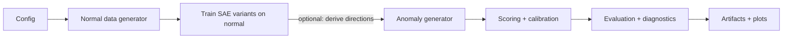

# Directional Deviation Detection Experiment (Protocol B) — Design

## Overview

Protocol B evaluates SAE variants as **resource-constrained directional anomaly detectors** under a strict latent budget
`H < N` on synthetic “sensor array” data.

This design document updates the existing Protocol B implementation to incorporate the improvements identified after the
first paper run:

- **5A** Break rotational symmetry in the normal distribution so “channel semantics” are learnable.
- **5B** Add a feature-space anomaly variant (anomalies along learned directions).
- **5C** Add localized scoring (max/top‑k pooling) and optional target-restricted scoring for single-channel anomalies.
- **5D** Add decoder alignment diagnostics (channel purity / axis alignment).
- **5E** Add optional per-latent signal normalization (z-score on validation normals) before thresholding/pooling.
- **5F** Add strength-controlled feature-direction anomalies (direction selection tied to π statistics and optional per-direction Δ scaling).

The implementation should follow repository conventions used by `sgnsae.experiments.polarity_dial`:
- dataclass configs with validation in `__post_init__`
- deterministic run directories under `<output_dir>/directional_deviation/<run_id>/`
- machine-readable JSON artifacts and minimal plots

---

## Architecture



Key change vs the current pipeline: when `shift_mode="feature_direction"`, anomaly generation depends on a trained
reference model (decoder directions). Therefore anomaly generation MUST happen **after** training the reference model.

---

## Components and Interfaces

### 1) Configuration

Module: `sgnsae.experiments.directional_deviation.config`

#### Root experiment config

`DirectionalDeviationExperimentConfig` (existing, extend):
- `output_dir: str`
- `device: Literal["auto","cpu","cuda"]`
- `verbose: bool`
- `log_every_n_steps: int`
- `log_every_n_epochs: int`
- `coverage_recall_target: float` (default `0.8`)
- `width_sweep: Optional[List[int]]`
- `data: DirectionalDeviationDataConfig`
- `anomaly: DirectionalDeviationAnomalyConfig`
- `thresholds: DirectionalDeviationThresholdConfig`
- `scoring: DirectionalDeviationScoringConfig` **(new; optional with defaults)**
- `models: List[DirectionalDeviationModelVariantConfig]`

#### Data config (normal generation)

`DirectionalDeviationDataConfig` (extend):
- `seed: int`
- `seeds: Optional[List[int]]`
- `num_train: int`
- `num_val: int`
- `num_test_normal: int`
- `num_test_high_per_channel: int`
- `num_test_low_per_channel: int`
- `num_channels: int` (`N`)
- `noise_std: float` (default `0.0`)
- `normal_mode: Literal[
    "standard_normal",
    "heteroskedastic_normal",
    "iid_non_gaussian",
    "non_gaussian_heteroskedastic"
  ]`
- `channel_stds: Optional[List[float]]`
  - required for `heteroskedastic_normal` and `non_gaussian_heteroskedastic`
- `ensure_unique_channel_stds: bool = True`
- `non_gaussian_dist: Optional[Literal["laplace","logistic","student_t"]]`
- `student_t_df: Optional[float]` (required if `non_gaussian_dist="student_t"`)
- `anomaly_eval_mode: Literal["materialize","stream"]` (default `"stream"`)
- `train_anomaly_fraction: float` (default `0.0`)
  - fraction of anomalies mixed into training (optional robustness experiment)

Validation rules:
- `num_channels > 0`, `d_hidden < num_channels` checked elsewhere
- `noise_std >= 0`
- if `channel_stds` is provided, length must equal `num_channels` and all values > 0
- if `ensure_unique_channel_stds`, enforce all stds distinct (within exact float equality)

#### Anomaly config

`DirectionalDeviationAnomalyConfig` (extend):
- `delta: float` (`Δ`)
- `shift_mode: Literal["single_channel","subset","feature_direction"]`
- `subset_size: Optional[int]` (required if `shift_mode="subset"`)
- Feature-direction fields (required if `shift_mode="feature_direction"`):
  - `direction_source: Literal["reference_model_decoder","fixed_random","per_model_decoder"]`
  - `num_directions: int` (`M`)
  - `reference_model_name: str` (default `"sign_aware_gated_sae"`)
  - `direction_selection: Literal["top_purity","top_pi_std","top_weight_norm","random","explicit"]`
  - `direction_latent_indices: Optional[List[int]]` (required if `direction_selection="explicit"`)
  - `normalize_directions: bool = True` (normalize to unit L2 norm)
  - `direction_delta_mode: Literal["fixed_input","fixed_pi_shift"] = "fixed_input"`
    - `fixed_input`: anomalies are `x' = x ± Δ v_k`
    - `fixed_pi_shift`: compute per-direction input deltas Δ_k so the reference latent has ∣Δπ∣≈Δ
  - `max_direction_input_delta: Optional[float] = None` (optional safety cap when `fixed_pi_shift` is enabled)
  - `num_test_high_per_direction: Optional[int]`
  - `num_test_low_per_direction: Optional[int]`
  - `base_samples: Literal["test_normal","val_normal"] = "test_normal"`

Notes:
- If `num_test_*_per_direction` is not provided, fall back to `data.num_test_*_per_channel` to avoid breaking old configs.
- For feature anomalies, “target index” is a direction index `k ∈ [0, M)`.

#### Scoring config (new)

`DirectionalDeviationScoringConfig`:
- `pooling: Literal["sum","max","topk"] = "sum"`
- `topk_k: Optional[int]` (required if pooling=`"topk"`)
- `signal_normalization: Literal["none","zscore"] = "none"`
- `normalization_eps: float = 1e-8`
- `target_restricted_scoring: bool = False`
  - Only meaningful for `shift_mode="single_channel"` (and optionally for feature directions if desired).
  - If true, scores for a target are computed only from latents assigned to that target.

#### Model variant config

Keep existing fields; no changes required for 5A–5F.

---

### 2) Data generation

Module: `sgnsae.experiments.directional_deviation.data`

#### Normal samples

Implement a single entrypoint:

```python
def generate_normal_splits(config: DirectionalDeviationDataConfig, device: str) -> dict[str, Tensor]:
    # returns x_train, x_val, x_test_normal
```

Sampling rules by `normal_mode`:

- `standard_normal`: `torch.randn((num, N))`
- `heteroskedastic_normal`: `torch.randn((num, N)) * channel_stds`
- `iid_non_gaussian`:
  - sample IID from the selected distribution with mean 0 and variance 1
- `non_gaussian_heteroskedastic`:
  - sample IID non-Gaussian variance 1, then multiply by `channel_stds`

Implementation detail (variance normalization):
- Laplace(0, b): var = 2 b^2 ⇒ choose `b = 1 / sqrt(2)` to get var=1
- Logistic(0, s): var = π^2 s^2 / 3 ⇒ choose `s = sqrt(3) / π` to get var=1
- Student‑t(df): var = df/(df-2) for df>2 ⇒ sample standard t and scale by `sqrt((df-2)/df)` to get var=1

Finally, add optional Gaussian noise:
- `x = x + noise_std * torch.randn_like(x)` for all modes.

Export:
- write `<run_dir>/data/generator_config.json` capturing all parameters and the resolved derived constants (e.g., Laplace b).
- write `<run_dir>/data/sampled_data.pt` containing small previews of each split for debugging.

---

### 3) Anomaly generation

Module: `sgnsae.experiments.directional_deviation.anomalies` **(new module recommended)**

Provide two generators:

#### Coordinate anomalies (existing behavior)

```python
def iter_coordinate_anomalies(
    base_x: Tensor,  # e.g., x_test_normal
    mode: Literal["single_channel","subset"],
    delta: float,
    ...
) -> Iterator[Batch]:
    ...
```

- `single_channel`: for each channel `j`, create `num_test_*_per_channel` samples by selecting base samples and shifting
  coordinate `j` by `±Δ`.
- `subset`: shift a fixed subset mask (deterministically constructed from seed or provided explicitly) by `±Δ`.

#### Feature-direction anomalies (new)

```python
def build_feature_directions(
    reference_model,  # trained model
    config: DirectionalDeviationAnomalyConfig,
    device: str,
) -> tuple[Tensor, dict]:  # directions (M,N), manifest dict
    ...
```

Direction extraction (`reference_model_decoder`):
- take decoder matrix `D` of shape `(N, H)`
- compute per-latent purity: `purity[i] = max_j |D[j,i]| / ||D[:,i]||_2`
- if `direction_selection="top_pi_std"`, compute the reference model's detection signal π on `base_samples` normals and select the top-`M` latents by `std(π_i)` (ties broken by latent index).
- if `direction_selection="top_weight_norm"`, select the top-`M` latents by the L2 norm of the raw decoder columns before normalization.
- select `M` latents by:
  - `top_purity`: top-M by purity (ties broken deterministically)
  - `top_pi_std`: top-M by std(π) on base samples (ties broken deterministically)
  - `top_weight_norm`: top-M by ||D[:,i]||_2 before normalization (ties broken deterministically)
  - `random`: random sample without replacement (seeded)
  - `explicit`: use `direction_latent_indices`
- directions are `v_k = D[:, latent_idx_k]`
- if `normalize_directions`, normalize each `v_k` to unit norm

Direction strength control:
- if `direction_delta_mode="fixed_input"`, use the global Δ from config.
- if `direction_delta_mode="fixed_pi_shift"`, compute per-direction input deltas Δ_k so the *reference* latent receives an approximately fixed first-order shift ∣Δπ∣=Δ:
  - let `w_k` be the raw direction vector (decoder column for the selected latent),
  - let `v_k = w_k / ||w_k||`,
  - set `Δ_k = Δ / (||w_k|| + ε)` and generate `x' = x ± Δ_k v_k`,
  - optionally clamp Δ_k by `max_direction_input_delta` and record any clipping in the manifest.

Then generate anomalies by perturbing base samples:

```python
def iter_feature_direction_anomalies(
    base_x: Tensor,
    directions: Tensor,  # (M, N) unit vectors
    delta: float,
    direction_input_deltas: Tensor | None,
    num_high_per_direction: int,
    num_low_per_direction: int,
    ...
) -> Iterator[Batch]:
    # yields (x_batch, labels_type, labels_target)
```

Labeling:
- `labels_target = direction_index k`
- `labels_type = 1` for +Δ, `2` for -Δ

Artifacts:
- write `data/anomaly_directions.pt` and `data/anomaly_manifest.json` in the **run root** (shared across models),
  because all models should evaluate on the same anomaly dataset when `direction_source="reference_model_decoder"`.

Ordering constraint:
- Ensure the reference model is trained before `build_feature_directions` runs.

---

### 4) Training and orchestration

Module: `sgnsae.experiments.directional_deviation.training`

No major changes. However, for `feature_direction` anomalies with `direction_source="reference_model_decoder"`:
- the runner MUST train `reference_model_name` first (or at least before anomaly directions are built).

A simple approach:
- Train all models, but if directions are needed, train the reference model first in the loop.

---

### 5) Detection signal extraction and scoring

Module: `sgnsae.experiments.directional_deviation.scoring`

#### Detection signal

Keep the existing abstraction:

- `pi(x)`: signed detection signal (pre-activation) of shape `(batch, H)`
- `e(x)`: non-negative evidence for baseline models of shape `(batch, H)`

Rules:
- GatedSAE: use `output["pi_gate"][0]` as `pi`
- SAE: use encoder pre-activations as `pi`
- Baseline evidence `e` MUST be non-negative (e.g., post-nonlinearity activations) to avoid two-sided leakage.

#### Thresholds (unchanged conceptually)

Optional signal normalization (5E):
- extract the raw detection signal on validation normals (π for sign-aware, evidence for baselines),
- if `signal_normalization="zscore"`, fit per-latent (μ,σ) on validation normals and transform to z-scores,
- compute τ/η and downstream scores in the normalized space,
- persist normalization stats alongside thresholds.

- Sign-aware thresholds:
  - `tau_plus[i] = quantile_q(pi[:,i])`
  - `tau_minus[i] = quantile_q(-pi[:,i])`
- Baseline thresholds:
  - `eta[i] = quantile_q(e[:,i])`

#### Pooling modes (new)

Implement a helper:

```python
def pool_exceedances(z: Tensor, mode: str, topk_k: int | None) -> Tensor:
    # z is non-negative exceedance per-latent, shape (batch, H)
    # returns pooled score shape (batch,)
```

- `sum`: `z.sum(dim=-1)`
- `max`: `z.max(dim=-1).values`
- `topk`: `z.topk(k=topk_k, dim=-1).values.sum(dim=-1)`

Apply this helper in BOTH:
- sign-aware scoring (high/low exceedances from `pi`)
- baseline scoring (high/low exceedances from `e` after partitioning)

#### Target-restricted scoring (optional)

When `target_restricted_scoring=true` AND `shift_mode="single_channel"`:
- precompute `latent_argmax_channel[i] = argmax_j |D[j,i]|`
- score for channel `j` uses only latents where `latent_argmax_channel[i] == j`
- if no latents for `j`, score = 0

This is intended for diagnostics and for more faithful “localized anomaly” evaluation.

---

### 6) Evaluation and diagnostics

Module: `sgnsae.experiments.directional_deviation.evaluation`

Required outputs (per model):
- `recall_high`, `recall_low` at fixed FPR (calibrated on validation normals)
- achieved FPR on `x_test_normal`
- per-target recall arrays:
  - `recall_high_by_target`
  - `recall_low_by_target`
- coverage:
  - `covered_targets = count_k(recall_high_by_target[k] >= target && recall_low_by_target[k] >= target)`
  - `coverage_fraction = covered_targets / num_targets`

Target kind:
- Coordinate anomalies: `target_kind="channel"`, `num_targets = N`
- Feature-direction anomalies: `target_kind="direction"`, `num_targets = M`

Diagnostics (5D):
- compute decoder alignment metrics from `D`:
  - `latent_argmax_channel[i]`
  - `latent_purity[i]`
  - `unique_channels_claimed`
  - summary stats (mean/median/p10/p90)
- write `models/<model_name>/decoder_alignment.json`
- include alignment summary in `models/<model_name>/evaluation.json` and in run-root `comparison_summary.json`

---

### 7) Plotting

Module: `sgnsae.experiments.directional_deviation.plotting`

Existing plots (keep):
- `recall_vs_width.png` (high + low curves per model)
- `coverage_vs_width.png` (if enabled)
- `score_histograms.png`

New plots (5D + 5C):
- `decoder_purity_hist.png` per model (or combined)
- `unique_channels_vs_width.png` for width sweeps
- (Optional) `recall_by_target_hist.png` to visualize per-target variability

All plots must be deterministic and saved under `<run_dir>/plots/`.

---

## Artifacts (Updated)

Run root:
- `config.json`
- `comparison_summary.json`
- `plots/`

Data:
- `data/generator_config.json`
- `data/anomaly_manifest.json`
- `data/anomaly_directions.pt` (only for `feature_direction`)
- `data/sampled_data.pt`

Per model:
- `models/<model_name>/model.pt`
- `models/<model_name>/training_metrics.json`
- `models/<model_name>/thresholds/*`
  - include `signal_normalization.(pt|json)` when enabled
- `models/<model_name>/evaluation.json`
- `models/<model_name>/decoder_alignment.json`
- `models/<model_name>/plots/*.png`

---

## Testing Strategy (Updated)

High-value unit tests:

1. **Symmetry-breaking generators**:
   - determinism by seed,
   - variance sanity checks for each normal_mode.
2. **Feature-direction anomalies**:
   - direction selection determinism (`top_purity`, `top_pi_std`, `random`),
   - perturbation equals `±Δ v_k` for `fixed_input` (within float tolerance),
   - perturbation equals `±Δ_k v_k` and Δ_k is recorded for `fixed_pi_shift`.
3. **Pooling modes**:
   - `sum`, `max`, `topk` correctness on toy tensors.
4. **Signal normalization**:
   - z-score transform produces mean≈0 and std≈1 (within tolerance) on a fixed tensor,
   - end-to-end threshold calibration produces finite τ/η/θ when enabled.
5. **Target-restricted scoring**:
   - score is 0 when no latents map to a channel,
   - uses only mapped latents otherwise.
6. **Decoder alignment diagnostics**:
   - purity=1 for one-hot columns,
   - expected purity for uniform columns.
