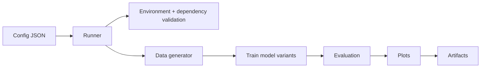

# Toy Model Geometry Validation (Protocol C) — Design

## Overview

Protocol C is a geometry-first validation suite intended to make the “anticorrelated pair consolidation” behavior visually obvious and quantitatively measurable in a controlled, low-dimensional setting.

The experiment trains baseline SAEs (non-negative latents) and the Sign-Aware Gated SAE on a synthetic 2D dataset where the ground truth contains `k` feature pairs. Each pair corresponds to two antipodal unit vectors on the unit circle, representing two opposing concepts along the same axis. The design produces:

1. Unit-circle geometry plots of learned decoder directions vs ground truth.
2. Signed activation histograms for a representative sign-aware latent (“Bi-Jump histogram”).
3. A “Pair Consolidation Rate” sweep as within-pair correlation varies from `-1` to `0`.

The implementation should follow patterns established by:
- `sgnsae.experiments.polarity_dial.*` (Protocol A)
- `sgnsae.experiments.directional_deviation.*` (Protocol B)

---

## Architecture



Directory layout (run root):

```
<output_dir>/toy_model_geometry_validation/<run_id>/
  config.json
  environment.json
  data/
    generator_config.json
    feature_directions.pt
    pair_active_mask_train.pt
    pair_active_mask_val.pt
    pair_active_mask_test.pt
    coeffs_train.pt
    coeffs_val.pt
    coeffs_test.pt
    sampled_data.pt
  models/<model_name>/
    model.pt
    model_config.json
    training_metrics.json
    evaluation.json
    plots/
      unit_circle_<model_name>.png
      bi_jump_hist_<model_name>_latent<i>.png
      training_loss_<model_name>.png
  comparison_summary.json
  pair_consolidation_sweep.json        (only if sweep enabled)
  plots/
    pair_consolidation_sweep.png       (only if sweep enabled)
```

---

## Components and Interfaces

### 1) Configuration

Module: `sgnsae.experiments.toy_model_geometry_validation.config`

Use dataclasses with validation in `__post_init__` and JSON load/save utilities analogous to Protocol A/B.

Key design constraints:
- Default config MUST support a full `pair_correlation_grid` spanning `[-1, 0]` (Requirement 3.3). This implies the default marginal feature probability should allow correlation `-1` (see “Correlation feasibility” below).
- All randomness MUST be deterministic and fully controlled by the config seed.
- Derive per-model seeds deterministically from `(data.seed, model_name)` to avoid ordering effects.

### 2) Data generation

Module: `sgnsae.experiments.toy_model_geometry_validation.data`

Entry point:

```python
def generate_toy2d_dataset(
    config: Toy2DDataConfig,
    device: str,
) -> dict[str, torch.Tensor]:
    ...
```

Outputs:
- `feature_directions`: shape `(2k, 2)`, unit norm.
- `pair_axis_directions`: shape `(k, 2)`, unit norm, where:
  - `feature_directions[2*j] = pair_axis_directions[j]`
  - `feature_directions[2*j+1] = -pair_axis_directions[j]`
- `x_train/x_val/x_test`: shape `(num, 2)`
- `coeffs_train/coeffs_val/coeffs_test`: shape `(num, 2k)` with non-negative magnitudes for each feature direction (ground truth); sign enters via whether the “minus” feature is active, because its direction is `-u`.
- `pair_active_mask_train/val/test`: shape `(num, k)` with `1` iff the pair was “eligible/active” for sampling on that example (used to (a) decouple overall sparsity from within-pair correlation and (b) make correlation tests unambiguous).

#### Direction construction

Direction modes:
- `uniform`: `k` angles evenly spaced in `[0, π)`, e.g. `θ_j = π * j / k`.
- `random`: sample `θ_j ~ Uniform(0, π)` with `torch.Generator` seeded by `data.seed`.

For each `θ_j`, define axis unit vector:
- `u_j = [cos θ_j, sin θ_j]`.

Feature directions:
- “plus” feature: `u_{j,+} = u_j`,
- “minus” feature: `u_{j,-} = -u_j`.

#### Within-pair activation sampling with target correlation

We explicitly decouple *overall pair participation* (sparsity / superposition level) from *within-pair correlation structure*.

Each pair first samples a participation mask `g ∈ {0,1}`:
- `g ~ Bernoulli(pair_axis_active_prob = ρ_pair)`.

If `g=0`, the pair contributes nothing (`f_plus=f_minus=0` and both coefficients are 0).

If `g=1`, the pair has two binary activations `(f_plus, f_minus) ∈ {0,1}^2` with equal marginals:
- `P(f_plus=1)=P(f_minus=1)=p`.

We target Pearson correlation `r` between `f_plus` and `f_minus` *restricted to the `g=1` subset*.

Let `q = P(f_plus=1, f_minus=1)`. Then:
- `corr(f_plus, f_minus) = (q - p^2) / (p(1-p))`
⇒ `q = p^2 + r * p(1-p)`.

Feasibility constraints:
- `max(0, 2p-1) ≤ q ≤ p`.

Validation:
- compute the feasible interval `[r_min, r_max]` implied by `p` and raise a `ValueError` if requested `r` is outside it.

Default choice to support `r=-1`:
- set `p=0.5` by default (so the conditional `g=1` distribution supports the full sweep `r ∈ [-1, 1]`),
- and set `pair_axis_active_prob` to a small value (recommended below) so the dataset is not trivially dense at `r=-1`.

Sampling procedure:
1. Sample `g ~ Bernoulli(ρ_pair)` for each `(sample, pair)` and record `pair_active_mask`.
2. Compute `q` from `(p, r)` for the conditional (`g=1`) distribution.
3. Define conditional probabilities (given `g=1`):
   - `P11 = q`
   - `P10 = p - q`
   - `P01 = p - q`
   - `P00 = 1 - 2p + q`
4. Sample a categorical variable with these 4 probabilities, then map to `(f_plus, f_minus)`.
5. Apply participation: `(f_plus, f_minus) ← g * (f_plus, f_minus)` so inactive pairs are guaranteed to be zero in the final coefficients.

Magnitudes:
- For each active feature, sample a non-negative magnitude `m ~ magnitude_dist` (default: log-normal with small sigma).
- Ground-truth coefficients for the `2k` features are `coeff[2*j] = f_plus * m_plus`, `coeff[2*j+1] = f_minus * m_minus`.

Data point:
- `x_clean = coeffs @ feature_directions` (matrix multiply, shape `(num, 2)`).
- Add noise if `noise_std > 0`.

Export:
- `data/generator_config.json` contains all parameters and derived values (`q`, feasible `[r_min, r_max]`, angles).
- `data/sampled_data.pt` stores a small preview (e.g., first 256 samples of each split).
- `data/pair_active_mask_*.pt` stores the per-split participation masks.

### 3) Training and orchestration

Module: `sgnsae.experiments.toy_model_geometry_validation.training`

Training should reuse existing model classes (`sgnsae.models.*`) and follow Protocol A/B training patterns:
- `n_instances=1`, `d_in=2`, `d_hidden=H`.
- Support variants:
  - `SAE` (ReLU),
  - `GatedSAE` sign_aware=false,
  - `GatedSAE` sign_aware=true.

One shared training loop:
```python
def run_training_for_variant(
    experiment_config: Toy2DExperimentConfig,
    data: dict[str, torch.Tensor],
    model_config: Toy2DModelVariantConfig,
) -> dict[str, Any]:
    ...
```

Key points:
- Deterministic DataLoader shuffling per model: use a CPU `torch.Generator` seeded by `model_seed`.
- Persist `training_metrics.json` with epoch-wise totals (total loss, reconstruction loss, sparsity loss, and `aux_loss` for gated models).
- Write plots (loss curves) under `models/<model_name>/plots/`.

### 4) Evaluation

Module: `sgnsae.experiments.toy_model_geometry_validation.evaluation`

Evaluation consumes:
- trained model,
- `feature_directions` and `pair_axis_directions`,
- held-out split `x_test` and `coeffs_test`.

#### Decoder extraction

Extract decoder matrix `D` as columns `D[:, i]` (shape `(2, H)` for `d_in=2`), then normalize:
- `d_i = D[:, i] / (||D[:, i]|| + eps)`.

#### Activation extraction (a_i(x))

All Protocol C runs SHOULD use `n_instances=1` to match the existing experiment code patterns. In the current `sgnsae` model implementations, `forward()` returns:

- `SAE.forward(x)`:
  - `output["y_pred"]`: shape `(n_instances, batch, d_in)`
  - `output["latents"]`: shape `(n_instances, batch, d_hidden)`
- `GatedSAE.forward(x)`:
  - `output["x_hat"]`: shape `(n_instances, batch, d_in)`
  - `output["pi_gate"]`: shape `(n_instances, batch, d_hidden)`
  - `output["latents"]`: shape `(n_instances, batch, d_hidden)`

Therefore, to extract a `(batch, d_hidden)` latent matrix for analysis, use:
- `latents_batch = output["latents"][0]`

Then the scalar activation series used in consolidation and histograms is:
- `a_i(x_test) = latents_batch[:, i]`

#### Alignment (for determinism and selection)

Compute cosine similarity between each latent direction and each ground-truth axis direction:
- For axes `u_j`, use `abs(cos(d_i, u_j))` as the axis similarity.

Use Hungarian matching (optional for 2D but keeps parity with Protocol A/B) to map latents to axes:
- `assignment = argmax` of total similarity over `k` axes (or `2k` features when appropriate).

Save alignment into `models/<model_name>/evaluation.json`:
- per-latent best axis index and similarity,
- per-axis best latent and similarity,
- summary statistics.

#### Pair Consolidation Rate

Compute, for each pair `j`, a ground-truth **signed coefficient** on the axis:
- `c_j(x) = coeff_plus(x) - coeff_minus(x)` where `coeff_plus = coeffs_test[:, 2*j]`, `coeff_minus = coeffs_test[:, 2*j+1]`.

For each pair `j`, search for a latent `i` that satisfies consolidation criteria:
1. Axis alignment:
   - `abs(cos(d_i, u_j)) ≥ min_axis_abs_cos`.
2. Signed activation tracking:
   - Let `a_i(x)` be the model activation for latent `i` on `x_test` (for sign-aware: `latents` output; for non-negative baselines: `latents` are non-negative).
   - Compute Pearson correlation between `a_i(x)` and `c_j(x)` on samples where `|c_j(x)| > 0`.
3. Both-sign usage:
   - Require at least `min_regime_samples` with `c_j>0` and `c_j<0`.
   - Require `mean(a_i | c_j>0) > 0` and `mean(a_i | c_j<0) < 0`.

Mark pair consolidated if any latent satisfies all criteria. Track “evaluable pairs” as pairs meeting the sample-count requirements.

Return:
- `pair_consolidation_rate_over_evaluable_pairs`,
- `evaluable_pair_fraction`,
- optional per-pair diagnostic table (best latent, axis cos, corr).

### 5) Plotting

Module: `sgnsae.experiments.toy_model_geometry_validation.plotting`

#### Unit circle plot

Create a 2D plot with:
- circle boundary,
- ground-truth directions (2k arrows or points),
- learned decoder directions (H points).

Persist:
- `models/<model_name>/plots/unit_circle_<model_name>.png`.

#### Bi-Jump histogram

Select a representative latent index deterministically, e.g.:
- choose pair `j=0`,
- choose the best-aligned latent to axis `u_0` among all latents.

Histogram `a_i(x_test)` and save:
- `models/<model_name>/plots/bi_jump_hist_<model_name>_latent<i>.png`.

Write metadata in `evaluation.json`:
- chosen `latent_index`,
- its axis alignment,
- histogram binning parameters.

#### Sweep plot

If `pair_correlation_grid` is set:
- aggregate consolidation metrics across sweep points into `pair_consolidation_sweep.json`.
- plot consolidation rate vs correlation for each model.

---

## Data Models

Suggested dataclasses (names can vary, but keep parity with Protocol A/B patterns):

- `Toy2DDataConfig`:
  - `seed: int`
  - `num_train: int`
  - `num_val: int`
  - `num_test: int`
  - `num_pairs: int`  (`k`)
  - `direction_mode: Literal["uniform","random"]`
  - `pair_axis_active_prob: float`  (`ρ_pair`, overall per-pair participation probability)
  - `pair_feature_prob: float`  (`p`)
  - `pair_correlation: float`  (`r`) OR `pair_correlation_grid: Optional[List[float]]`
  - `magnitude_dist: Literal["lognormal","constant"]`
  - `lognormal_mu: float`
  - `lognormal_sigma: float`
  - `noise_std: float`

- `Toy2DModelVariantConfig`:
  - `name: str`
  - `sae_class: Literal["SAE","GatedSAE"]`
  - `sign_aware: bool`
  - `d_hidden: int`
  - `sparsity_coeff: float`
  - `learning_rate: float`
  - `num_epochs: int`
  - `batch_size: int`
  - `adam_betas: tuple[float, float]`

- `Toy2DEvaluationConfig`:
  - `min_axis_abs_cos: float` (default `0.9`)
  - `min_activation_corr: float` (default `0.8`)
  - `min_regime_samples: int` (default `100`)
  - `hist_num_bins: int` (default `80`)

- `Toy2DExperimentConfig`:
  - `output_dir: str`
  - `device: Literal["auto","cpu","cuda"]`
  - `verbose: bool`
  - `log_every_n_steps: int`
  - `data: Toy2DDataConfig`
  - `evaluation: Toy2DEvaluationConfig`
  - `models: list[Toy2DModelVariantConfig]`

---

## Recommended Defaults (to reproduce Protocol C expectations)

Protocol C in `main.tex` specifies qualitative expectations (antipodal baseline geometry, single-axis sign-aware geometry, tri-modal signed activation histogram), but does not prescribe exact hyperparameters. The following defaults are recommended so a junior researcher can reproduce the expected plots without manual tuning:

Data:
- `num_pairs (k)`: 64 (smoke: 8)
- `direction_mode`: `uniform`
- `pair_axis_active_prob (ρ_pair)`: `0.05` (smoke: `0.2`)  *(keeps the dataset in a sparse/superposition regime while still allowing `pair_correlation=-1`)*
- `pair_feature_prob (p)`: `0.5` (enables `pair_correlation=-1` in the conditional `g=1` distribution)
- `pair_correlation`: `-1.0` for “single-point qualitative” runs
- `pair_correlation_grid`: `[-1.0, -0.75, -0.5, -0.25, 0.0]` for sweeps
- `magnitude_dist`: `lognormal` with `lognormal_mu=0.0`, `lognormal_sigma=0.25`
- `noise_std`: `0.01`
- `num_train/num_val/num_test`: `100_000 / 10_000 / 10_000` (smoke: `2_000 / 512 / 512`)

Models:
- “Phase transition” mode (capacity parity, recommended for the sweep):
  - baseline: `GatedSAE` with `sign_aware=false`, `d_hidden=2k`
  - sign-aware: `GatedSAE` with `sign_aware=true`, `d_hidden=2k`
- “Efficiency comparison” mode (recommended as an additional `r=-1` run):
  - baseline: `GatedSAE` with `sign_aware=false`, `d_hidden=2k`
  - sign-aware: `GatedSAE` with `sign_aware=true`, `d_hidden=k`

Training:
- `num_epochs`: 50 (smoke: 3–5)
- `batch_size`: 1024 (smoke: 256)
- `learning_rate`: `1e-4` to `3e-4` (start with `1e-4` for gated models)
- `sparsity_coeff`: `1e-3` (adjust if the sign-aware histogram does not show a clear dead zone)

Evaluation:
- `min_axis_abs_cos`: `0.9`
- `min_activation_corr`: `0.8`
- `min_regime_samples`: 200
- `hist_num_bins`: 80

These defaults SHOULD be encoded into checked-in example configs (see tasks).

---

## Error Handling

- Config validation MUST catch:
  - invalid counts (≤0),
  - invalid probabilities (`p` not in `[0,1]`),
  - infeasible `pair_correlation` values for the chosen `p`,
  - `d_hidden ≤ 0`,
  - missing fields required by `magnitude_dist`.
- Dependency validation at CLI start:
  - fail fast if torch/numpy/matplotlib/scipy imports fail.
- Training instability:
  - detect NaNs/inf in loss, stop early, persist partial artifacts.
- Evaluation:
  - if too few regime samples, mark pairs not evaluable and avoid NaNs in correlation computations.

---

## Testing Strategy

Use `unittest` and mirror the existing repository’s testing style.

Recommended tests:

1. **Data determinism**
   - Same seed/config ⇒ identical tensors for directions, coefficients, and samples.
2. **Antipodal construction**
   - Check `u_minus = -u_plus` and `||u||≈1`.
3. **Correlation sanity**
   - For `r ∈ {-1, -0.5, 0}`, generate a large batch and verify empirical correlation is within tolerance (e.g., ±0.05), computed on the subset where `pair_active_mask==1` for the tested pair (so the estimate matches the intended conditional distribution).
4. **Perfect-model consolidation**
   - Construct a toy “model” with decoder exactly equal to the `k` axes and activations equal to signed coefficients; verify consolidation rate ≈ 1 at `r=-1`.
5. **Baseline non-consolidation**
   - Construct a non-negative activation model; verify consolidation criteria fail because negative-regime mean activation cannot be < 0.
6. **End-to-end smoke**
   - Run a tiny config (e.g., `k=4`, a few epochs) and assert artifact paths exist.
